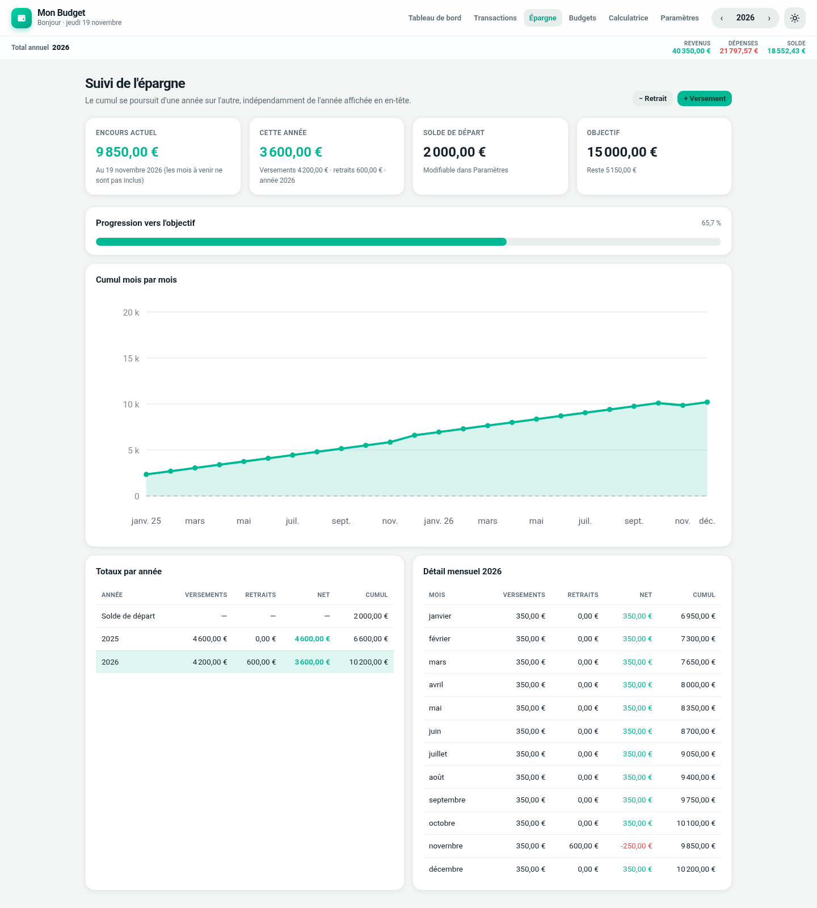

# Mon Budget

Application web de budget personnel, simple et autonome : saisissez vous-même vos revenus et dépenses, puis suivez-les sur l’année et au-delà. Aucune connexion bancaire, aucun compte à créer.

**[Essayer en ligne](https://khaldiahmed91-cyber.github.io/Mon-Budget/)**

---

## Fonctionnalités

- **Tableau de bord** annuel : revenus, dépenses (hors épargne), solde, taux d’épargne, graphiques et tableau mois par mois
- **Transactions** : ajout, modification, suppression, filtres et recherche
- **Récurrences** mensuelles ou annuelles, avec date de fin optionnelle et action « Arrêter… »
- **Catégories et sous-catégories** : création, renommage, suppression ; détail dépliable avec montants et pourcentages
- **Budgets** mensuels par catégorie, avec suivi de l’avancement
- **Suivi d’épargne pluriannuel** : encours cumulé d’une année sur l’autre, versements, retraits, objectif
- **Calculatrice** de projection sur N années (1, 5, 10, 20, 30 ou saisie libre), avec évolution annuelle composée optionnelle
- **Export / import** JSON et export CSV
- **Mode sombre** et affichage adapté au mobile

## Utilisation locale

1. Téléchargez le fichier [`index.html`](index.html).
2. Ouvrez-le dans votre navigateur (double-clic suffit, aucun serveur ni installation).
3. Vos données restent dans ce navigateur. Pensez à exporter régulièrement une sauvegarde JSON.

## Confidentialité

Toutes les données restent **100 % locales**, dans le `localStorage` de votre navigateur. Aucun serveur n’est contacté, aucune donnée n’est envoyée ailleurs. Pour changer d’appareil, utilisez l’export JSON.

## Captures d’écran

Tableau de bord :

Suivi de l’épargne :

Calculatrice de projection :

## Licence

Distribué sous licence [MIT](LICENSE). Copyright © 2026 Ahmed Khaldi.

## Contributions

Les contributions sont les bienvenues : issues, suggestions et pull requests.

---

## English

**Mon Budget** is a self-contained personal budget web app (French UI, EUR). You enter income and expenses yourself — there is no bank connection.

**[Try it online](https://khaldiahmed91-cyber.github.io/Mon-Budget/)** or download [`index.html`](index.html) and open it in a browser. Features include monthly and yearly recurrences with optional end dates, categories and subcategories, monthly budgets, a multi-year savings tracker, an N-year projection calculator, JSON/CSV export, and dark mode.

All data stays in your browser’s `localStorage`. Nothing is sent to a server. Licensed under the [MIT License](LICENSE). Contributions are welcome.
